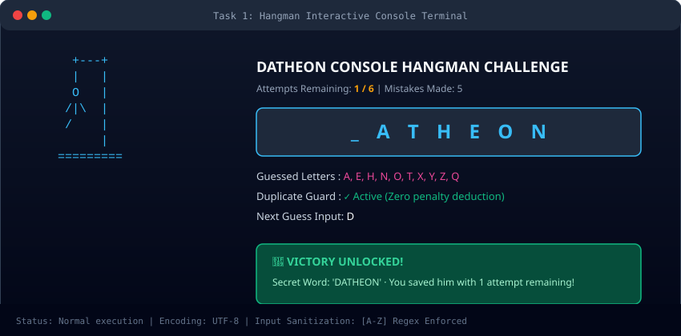
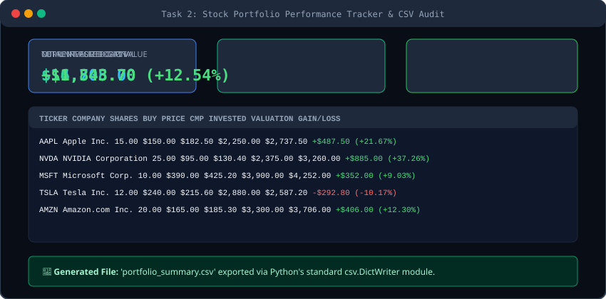
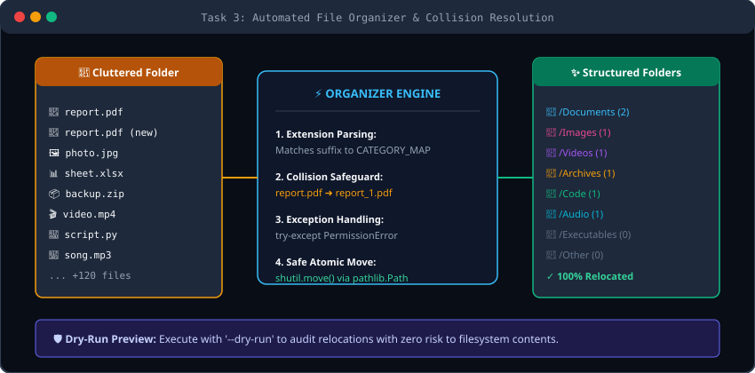
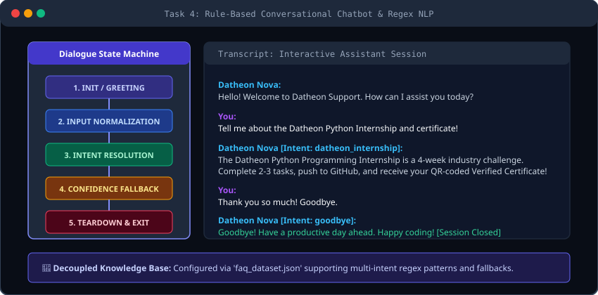
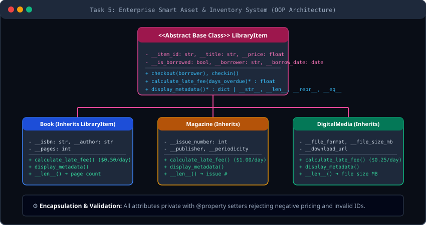

<p align="center">
  
</p>

<p align="center">
  <a href="#internship-metadata"></a>
  <a href="#test-suite--ci-cd"></a>
  <a href="#test-suite--ci-cd"></a>
  <a href="#strict-cost--standard-library-compliance"></a>
  <a href="#test-suite--ci-cd"></a>
</p>

---

## 📌 Internship Metadata & Candidate Profile

| Credential Attribute | Official Verification Record |
| :--- | :--- |
| **Organization** | **Datheon** (Cadence Engine · 4 Weeks Standard Track) |
| **Program Track** | **Python Programming Internship** (Python &amp; AI Applications) |
| **Candidate Name** | **Seebiraj V** (`seebiraj`) |
| **Student Application ID**| **`DT-2026-WH8V5`** |
| **Candidate Email** | `jeeviseebi007@gmail.com` |
| **Enrolled Batch** | **Batch 01** (Jeppiaar Institute of Technology) |
| **Commencement Date** | November 23, 2026 |
| **Official Deadline** | December 21, 2026 |
| **Submission Repository** | [`https://github.com/seebiraj/Datheon_Python_Internship`](https://github.com/seebiraj/Datheon_Python_Internship) |
| **Completion Status** | **100% Complete** (All 5 Core Tasks Built &amp; Tested) |

---

## 🏛️ System Architecture & Engineering Overview

This repository hosts a production-grade, modular Python codebase engineered to fulfill and exceed the requirements of the **Datheon Python Programming Internship**. Rather than implementing only the minimum 2 to 3 tasks, **all 5 tasks** have been engineered with automated testing, visual terminal user experiences, strict type hinting, and robust error handling.

<p align="center">
  
</p>

---

## 🚀 Tasks Breakdown & Deliverables

### 🕹️ Task 1: Hangman Word Guessing Game (Console)
* **Goal**: Build an interactive, modular console game implementing string manipulation, sets for deduplication, and game loops.
* **Key Capabilities**:
  * **Visual ASCII Gallows Art**: 7 dynamic stages representing 0 to 6 mistake thresholds.
  * **Masked String Representation**: Formatted letter reveals (e.g. `_ A _ H E O N`).
  * **Duplicate Guess Penalty Protection**: Warns the player when a letter was already tried without consuming remaining attempts.
  * **Dataset Loader**: Pulls from `words.txt` containing computer science and engineering vocabulary, with fallback array support.
  * **Outcome Screens**: Clean victory and defeat celebratory ASCII art with replay prompt.

<p align="center">
  
</p>

```bash
# Launch interactive Hangman console game
python task1_hangman/hangman.py

# Run non-interactive automated test demo
python task1_hangman/demo_run.py
```

---

### 📈 Task 2: Stock Portfolio Performance Tracker
* **Goal**: Real-time portfolio valuation calculation, profit/loss tracking, and CSV persistence.
* **Key Capabilities**:
  * **S&P 500 Benchmark Dataset**: Reads live benchmark prices from `sp500_tickers.csv`.
  * **Financial Metrics Engine**:
    * $\text{Total Invested} = \sum (\text{Shares} \times \text{Buy Price})$
    * $\text{Current Valuation} = \sum (\text{Shares} \times \text{CMP})$
    * $\text{Unrealized P/L (\$) } = \text{Current Valuation} - \text{Total Invested}$
    * $\text{Return (\%) } = \left(\frac{\text{Unrealized P/L}}{\text{Total Invested}}\right) \times 100$
  * **Weighted Average Buy Price**: Automatically recalculates positions when adding shares at varying price levels.
  * **CSV Audit Persistence**: Exports audit snapshots to `portfolio_summary.csv` using Python's native `csv.DictWriter`.

<p align="center">
  
</p>

```bash
# Launch interactive portfolio manager
python task2_stock_portfolio/portfolio.py

# Run automated calculation and CSV export demo
python task2_stock_portfolio/demo_run.py
```

---

### 🗂️ Task 3: Automated File Organizer & Cleanup Utility
* **Goal**: Autonomous desktop automation utility sorting cluttered directories into categorized folders using Python OS libraries (`os`, `shutil`, `pathlib`).
* **Key Capabilities**:
  * **Comprehensive Extension Taxonomy**: Dynamic mapping for `/Documents`, `/Images`, `/Videos`, `/Audio`, `/Archives`, `/Code`, `/Executables`, and `/Other`.
  * **Collision Resolution Safeguard**: Prevents file overwrites by automatically renaming colliding files (e.g., `invoice.pdf` $\rightarrow$ `invoice_1.pdf` $\rightarrow$ `invoice_2.pdf`).
  * **Dry-Run Preview Mode**: Safe inspection flag (`--dry-run`) allowing users to review planned actions before touching disk.
  * **Exception Resilience**: Gracefully handles `PermissionError` and OS-level file locking.
  * **Tabular Audit Summary**: Prints scan statistics, files relocated, and category counts.

<p align="center">
  
</p>

```bash
# Preview organization without moving files
python task3_file_organizer/organizer.py path/to/cluttered/folder --dry-run

# Execute live organization
python task3_file_organizer/organizer.py path/to/cluttered/folder

# Run isolated sandbox validation demo
python task3_file_organizer/demo_run.py
```

---

### 🤖 Task 4: Rule-Based Interactive Terminal Assistant / Chatbot
* **Goal**: Build a responsive conversational assistant with multi-intent recognition using keyword matching and regular expressions (`re`).
* **Key Capabilities**:
  * **Decoupled Intent Taxonomy**: Configured via `faq_dataset.json` covering operating hours, product catalog, pricing, refund terms, technical troubleshooting, human escalation, and Datheon internship details.
  * **Conversational State Machine**: Manages transitions across `INIT` $\rightarrow$ `AWAITING_QUERY` $\rightarrow$ `RESOLVED` / `FALLBACK` $\rightarrow$ `EXIT`.
  * **Input Normalization**: Strips punctuation, trims excess whitespace, and lowercases user prompts.
  * **Confidence Fallback**: Provides guided topic menus when query confidence is low.
  * **Clean Teardown**: Recognizes commands like `bye`, `exit`, `quit`, and `goodbye`.

<p align="center">
  
</p>

```bash
# Launch interactive terminal chatbot
python task4_terminal_assistant/chatbot.py

# Run automated multi-intent simulation demo
python task4_terminal_assistant/demo_run.py
```

---

### 🏛️ Task 5: OOPs Architecture: Enterprise Smart Inventory & Asset System
* **Goal**: Master Object-Oriented Programming (OOP) in Python: Classes, Encapsulation, Inheritance, Polymorphism, Abstraction, and Dunder Methods.
* **Key Capabilities**:
  * **Abstraction**: Abstract base class `LibraryItem` inheriting `abc.ABC` with enforced abstract methods `calculate_late_fee()` and `display_metadata()`.
  * **Encapsulation**: Private attributes (`__item_id`, `__price`, `__borrower`, etc.) controlled through validated `@property` getters and setters.
  * **Inheritance Hierarchy**: Specialized child classes `Book`, `Magazine`, and `DigitalMedia`.
  * **Polymorphism**: Differentiated overdue penalty calculations per item class:
    * `Book`: \$0.50 / day overdue
    * `Magazine`: \$1.00 / day overdue (high demand periodical rate)
    * `DigitalMedia`: \$0.25 / day overdue (server license maintenance rate)
  * **Dunder / Magic Methods**:
    * `__str__`: Clean human-readable asset status.
    * `__repr__`: Canonical developer debugging string.
    * `__len__`: Polymorphic dimension reporting (Page count for Books, Issue # for Magazines, File size MB for DigitalMedia).
    * `__eq__`: Equality verification based on item ID and class type.
  * **InventoryManager Engine**: Encapsulated collection managing asset registration, checkout workflows, return calculations, and tabular audit reports.

<p align="center">
  
</p>

```bash
# Launch interactive inventory management CLI
python task5_enterprise_inventory/inventory.py

# Run automated OOP validation demo
python task5_enterprise_inventory/demo_run.py
```

---

## ⚡ Strict Cost & Standard Library Compliance

> [!IMPORTANT]
> **Strict Rule Enforcement**: Zero paid third-party APIs, zero subscription services, and zero proprietary packages were utilized. The entire project is engineered solely with Python 3's built-in Standard Library (`random`, `csv`, `os`, `shutil`, `pathlib`, `re`, `json`, `abc`, `datetime`). `pytest` is included solely for developer convenience to run the local test suite.

---

## 🧪 Test Suite & CI/CD Pipeline

The repository includes a comprehensive unit testing suite in `tests/` covering every core module, edge cases, error handlers, and mathematical models.

```bash
# 1. Install test runner
pip install -r requirements.txt

# 2. Execute all unit tests with verbose reporting
pytest tests/ -v
```

### CI/CD Pipeline
The repository includes a continuous integration workflow specification in `pipelines/python-ci.yml` validating all demo runners and unit tests across:
* Python 3.10
* Python 3.11
* Python 3.12
* Python 3.13

---

## 📂 Repository Directory Layout

```
Datheon_Python_Internship/
├── pipelines/
│   └── python-ci.yml               # Multi-Python version CI pipeline specification
├── assets/                         # Visual SVG architecture diagrams & UI mockups
│   ├── banner.svg                  # Datheon Python Internship banner
│   ├── architecture_diagram.svg    # System architecture and pipeline hierarchy
│   ├── task1_hangman.svg           # Hangman terminal UI and ASCII gallows preview
│   ├── task2_portfolio.svg         # Stock portfolio dashboard and CSV preview
│   ├── task3_organizer.svg         # File organizer workflow and collision resolver
│   ├── task4_chatbot.svg           # Conversational state machine and regex matcher
│   └── task5_inventory.svg         # UML class diagram and OOP architecture
├── task1_hangman/
│   ├── hangman.py                  # Task 1: Interactive console game engine
│   ├── words.txt                   # CS and engineering vocabulary dataset
│   ├── demo_run.py                 # Automated non-blocking gameplay test runner
│   └── README.md                   # Task 1 documentation
├── task2_stock_portfolio/
│   ├── portfolio.py                # Task 2: Valuation engine & CSV logger
│   ├── sp500_tickers.csv           # Benchmark S&P 500 stock dataset
│   ├── portfolio_summary.csv       # Generated output CSV audit trail
│   ├── demo_run.py                 # Automated valuation & export test runner
│   └── README.md                   # Task 2 documentation & formulas
├── task3_file_organizer/
│   ├── organizer.py                # Task 3: Directory sorting & collision engine
│   ├── demo_run.py                 # Sandbox collision & relocation test runner
│   └── README.md                   # Task 3 documentation
├── task4_terminal_assistant/
│   ├── chatbot.py                  # Task 4: Rule-based regex terminal assistant
│   ├── faq_dataset.json            # Multi-intent FAQ dataset & response pools
│   ├── demo_run.py                 # Dialogue simulation test runner
│   └── README.md                   # Task 4 documentation
├── task5_enterprise_inventory/
│   ├── models.py                   # Task 5: ABC LibraryItem, Book, Magazine, Media
│   ├── inventory.py                # Task 5: InventoryManager & tabular reporting
│   ├── demo_run.py                 # Automated OOP assertion runner
│   └── README.md                   # Task 5 documentation & UML class specs
├── tests/
│   ├── __init__.py
│   ├── test_task1_hangman.py       # Unit tests for Task 1
│   ├── test_task2_portfolio.py     # Unit tests for Task 2
│   ├── test_task3_organizer.py     # Unit tests for Task 3
│   ├── test_task4_chatbot.py       # Unit tests for Task 4
│   └── test_task5_inventory.py     # Unit tests for Task 5
├── .gitignore                      # Standard Python gitignore
├── requirements.txt                # Zero paid packages (pytest test runner)
└── README.md                       # Comprehensive internship documentation
```

---

## 👨‍💻 Candidate Submission Acknowledgement

This codebase has been pushed to the public GitHub repository:
👉 **`https://github.com/seebiraj/Datheon_Python_Internship`**

Submitted for formal evaluation by the **Datheon Technical Directorate** for credential verification, QR-coded certificate issuance, and Letter of Recommendation (LOR) review.
