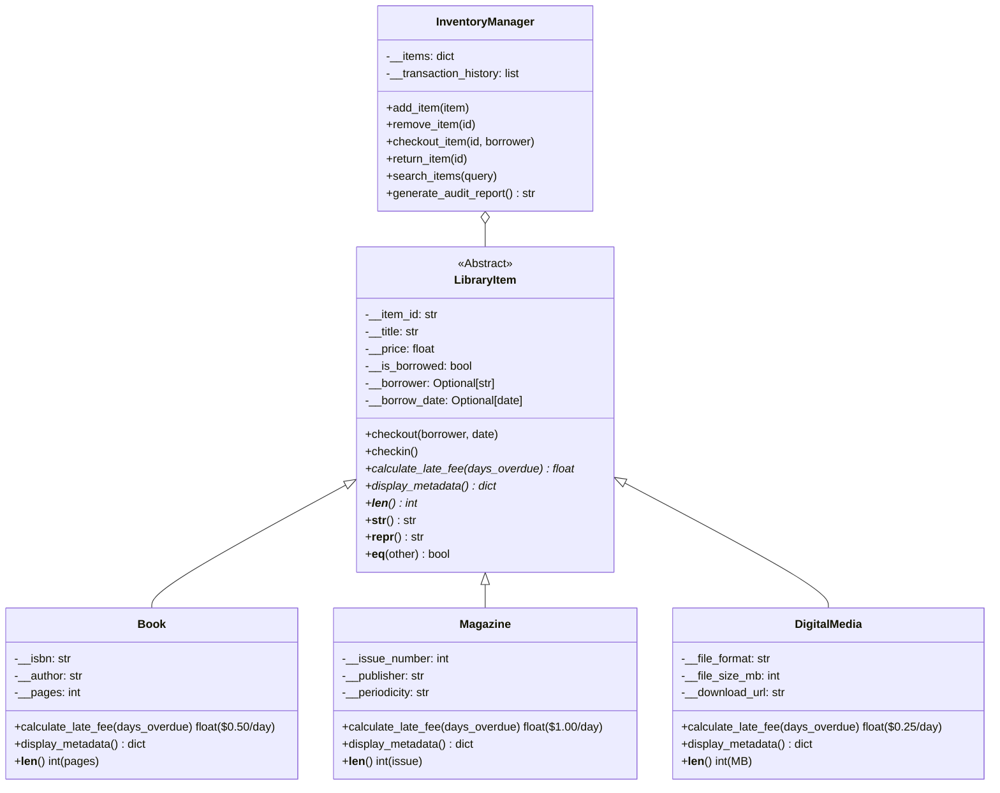

# Task 5: Enterprise Smart Inventory & Asset System (OOP Architecture)

## Overview & Goal
Architect a production-grade inventory and asset management system using strict Object-Oriented Programming (OOP) paradigms in Python:
- **Abstraction**: Abstract base class contract using `abc.ABC` and `@abstractmethod`.
- **Encapsulation**: Private attributes (`__item_id`, `__price`, `__borrower`), property decorators (`@property`, `@setter`) with runtime validation.
- **Inheritance**: Derived subclasses `Book`, `Magazine`, and `DigitalMedia` extending the common base.
- **Polymorphism**: Overridden `calculate_late_fee()` algorithms tailored per asset category and customizable metadata.
- **Magic / Dunder Methods**:
  - `__str__`: Human-readable user string.
  - `__repr__`: Canonical developer debugging representation.
  - `__len__`: Dimension query (Pages for books, issue number for magazines, size in MB for digital files).
  - `__eq__`: Identity equality verification.

## Class Hierarchy & Architecture


## File Manifest
- `models.py`: Domain entity models defining `LibraryItem`, `Book`, `Magazine`, and `DigitalMedia`.
- `inventory.py`: Enterprise orchestrator `InventoryManager` and interactive CLI.
- `demo_run.py`: Automated assertion harness validating all OOP principles.

## How to Run
```bash
# Interactive inventory CLI
python task5_enterprise_inventory/inventory.py

# Automated OOP validation demo
python task5_enterprise_inventory/demo_run.py
```
